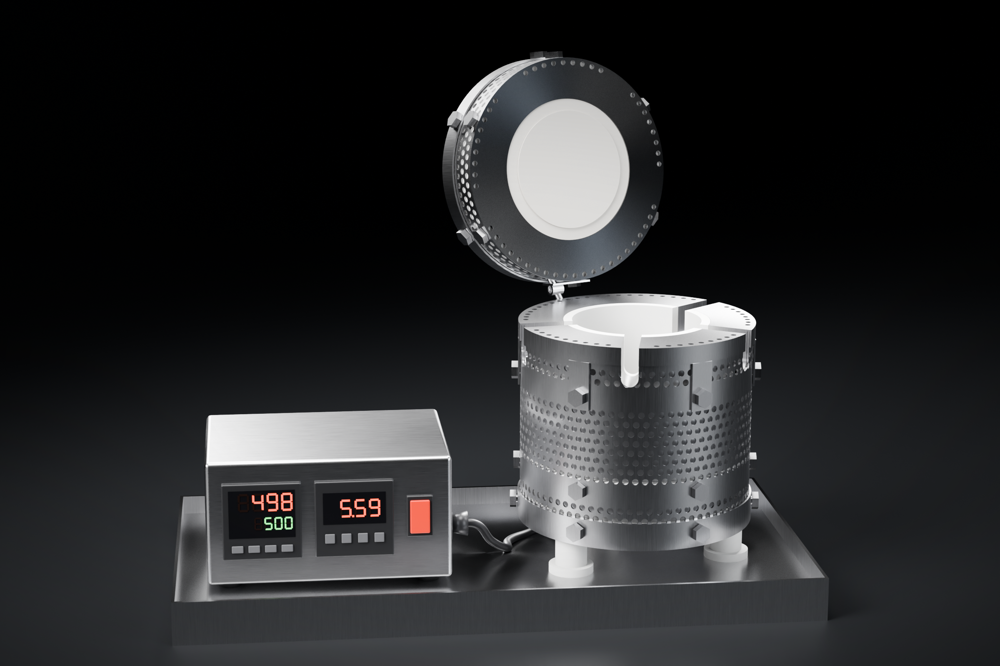
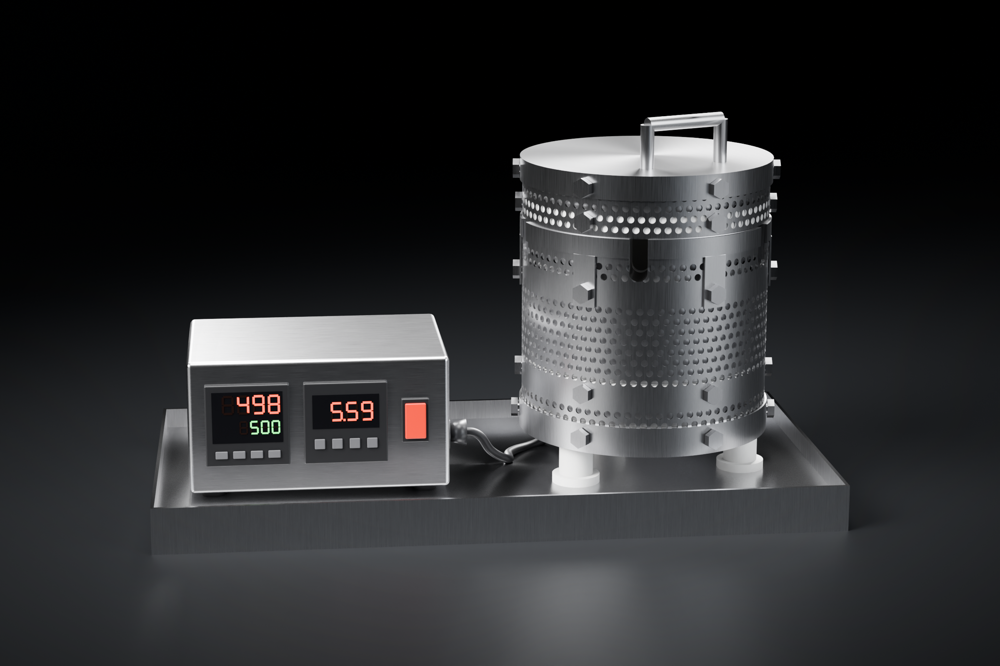
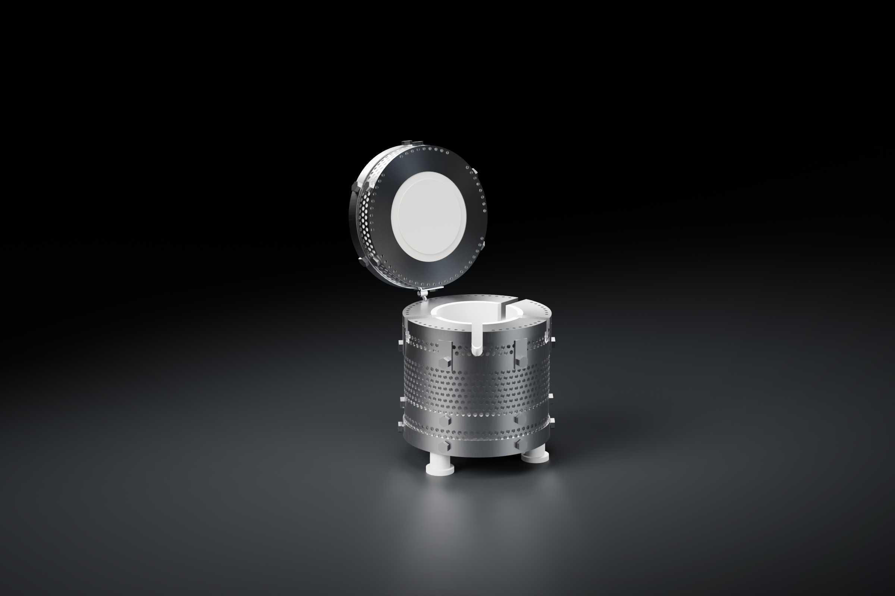
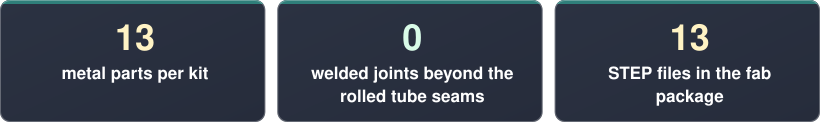
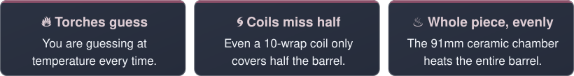
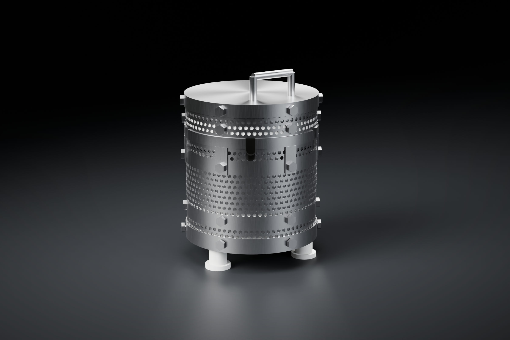
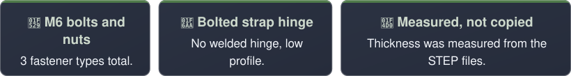

# Nice Dreamz Heat & Clean Glass Oven

**The perfect heat, every time. Drop in your terp slurper, banger, or ball vape -- the oven heats the entire barrel evenly to your exact target temperature. When you're done, crank it up and burn off all the char and resin too.**

**In one sentence:** an open-hardware design for a bolt-together stainless and ceramic oven that heats glass dab pieces to a set temperature with a PID controller, then runs hotter to burn them clean.

**Status:** design complete, 13-part metal fab package ([FAB_PACKAGE_2026-11-08-R2](FAB_PACKAGE_2026-11-08-R2/)) generated from Python CAD, every STEP checked as one solid and re-measured from the file. **October 2026: the first full plastic test print came back from the factory and was test-fit on the real ceramic core** (photos below). Stainless samples are next.




*With tray and controller (controller box is a concept)*



**Watch it build itself (2026-11-08 R2):** https://nicedreamzapp.github.io/Heat-N-Clean-Glass-Oven/viewer-oven-build.html · [MP4](Renders/oven_builds_itself_2026-11-08-R2.mp4)

## Latest: plastic test print on the real ceramic (October 2026)

Before cutting steel, the factory printed every part in plastic from the fab package and assembled it around the real ceramic heater core. These are their photos.

| | | |
|---|---|---|
|  |  |  |
|  |  | [Video: ceramic fit check (9 s)](Prototype%20Photos/2026-10%20plastic%20test%20print/06_ceramic_fit_check.mp4) |

<a id="oven"></a>
<picture><source media="(max-width: 610px), (min-width: 768px) and (max-width: 895px)" srcset="https://raw.githubusercontent.com/nicedreamzapp/Heat-N-Clean-Glass-Oven/main/assets/readme/s01-banner-m.svg"><source media="(max-width: 1149px)" srcset="https://raw.githubusercontent.com/nicedreamzapp/Heat-N-Clean-Glass-Oven/main/assets/readme/s01-banner-mid.svg"></picture>
<picture><source media="(max-width: 610px), (min-width: 768px) and (max-width: 895px)" srcset="https://raw.githubusercontent.com/nicedreamzapp/Heat-N-Clean-Glass-Oven/main/assets/readme/s01-r1-m.svg"><source media="(max-width: 1149px)" srcset="https://raw.githubusercontent.com/nicedreamzapp/Heat-N-Clean-Glass-Oven/main/assets/readme/s01-r1-mid.svg"></picture>

Heat & Clean is a precision ceramic oven that heats your glass pieces to the perfect dabbing or vaping temperature -- no torch, no guessing, no hot spots. Set your temp, drop in your piece, and get a perfect session every time. And when your glass gets gunked up? Same oven, higher temp, walk away. Comes back looking brand new.

**Spin every part in your browser — no CAD software needed:** https://nicedreamzapp.github.io/Heat-N-Clean-Glass-Oven/viewer-complete.html
Click **Separate** to pull the oven apart; every part is labelled.

**Whole oven in 3D:** https://nicedreamzapp.github.io/Heat-N-Clean-Glass-Oven/viewer-complete.html
**Full parts list:** [PARTS_LIST.md](PARTS_LIST.md) · **Current fab package:** [FAB_PACKAGE_2026-11-08-R2/](FAB_PACKAGE_2026-11-08-R2/) — 13 STEP + STL files, bilingual README · **What changed (2026-11-08 R2):** https://nicedreamzapp.github.io/Heat-N-Clean-Glass-Oven/change-sheets-2026-11-08-R2.html


<a id="problem"></a>
<picture><source media="(max-width: 610px), (min-width: 768px) and (max-width: 895px)" srcset="https://raw.githubusercontent.com/nicedreamzapp/Heat-N-Clean-Glass-Oven/main/assets/readme/s02-banner-m.svg"><source media="(max-width: 1149px)" srcset="https://raw.githubusercontent.com/nicedreamzapp/Heat-N-Clean-Glass-Oven/main/assets/readme/s02-banner-mid.svg"></picture>
<picture><source media="(max-width: 610px), (min-width: 768px) and (max-width: 895px)" srcset="https://raw.githubusercontent.com/nicedreamzapp/Heat-N-Clean-Glass-Oven/main/assets/readme/s02-r1-m.svg"><source media="(max-width: 1149px)" srcset="https://raw.githubusercontent.com/nicedreamzapp/Heat-N-Clean-Glass-Oven/main/assets/readme/s02-r1-mid.svg"></picture>

Torches and coil heaters can't evenly heat modern glass pieces.

| | |
|---|---|
|  |  |

**With a torch**, only the bottom dish and a small portion of the barrel gets heated. You're guessing at temperature every single time -- too hot and you scorch it, too cool and you waste product.

**With a coil heater**, even a 10-wrap coil only covers half the barrel. The top half never reaches temp. Uneven heat means uneven flavor.


### The Solution

The Heat & Clean oven surrounds the **entire piece** in even, controlled heat.

| | |
|---|---|
|  |  |

The 90mm tall ceramic chamber heats the **whole barrel** -- top to bottom, all the way around. Tower-style terp slurpers with 80mm barrels fit completely inside. Set your exact target temperature and hit it every time. Lower temps, better flavor, zero waste.

### Two Modes, One Device

### Heating Mode
Drop in your terp slurper, banger, or ball vape heater. Set your preferred dabbing or vaping temperature -- most sessions run in the 500-600 F sweet spot. The PID controller brings it to temp and holds it perfectly. Pull it out, attach it, and enjoy a perfect session every time.

### Cleaning Mode
Crank the temperature up. Walk away. The oven burns off all char, resin, and buildup. Come back to glass that looks brand new. No chemicals, no scrubbing, no soaking. The 6-hour auto-shutoff timer means you can set it and forget it.


<a id="specs"></a>
<picture><source media="(max-width: 610px), (min-width: 768px) and (max-width: 895px)" srcset="https://raw.githubusercontent.com/nicedreamzapp/Heat-N-Clean-Glass-Oven/main/assets/readme/s03-banner-m.svg"><source media="(max-width: 1149px)" srcset="https://raw.githubusercontent.com/nicedreamzapp/Heat-N-Clean-Glass-Oven/main/assets/readme/s03-banner-mid.svg"></picture>
<picture><source media="(max-width: 610px), (min-width: 768px) and (max-width: 895px)" srcset="https://raw.githubusercontent.com/nicedreamzapp/Heat-N-Clean-Glass-Oven/main/assets/readme/s03-r1-m.svg"><source media="(max-width: 1149px)" srcset="https://raw.githubusercontent.com/nicedreamzapp/Heat-N-Clean-Glass-Oven/main/assets/readme/s03-r1-mid.svg"></picture>

- **Precision PID temperature control** -- REX-C100 controller holds your target temp within a few degrees
- **Locked-down interface** -- just set your temp and go, no confusing menus
- **Triple safety system** -- software limit (870 F) + overheat alarm (900 F) + thermal fuse (930 F)
- **6-hour auto-shutoff** -- DH48S timer relay cuts power automatically
- **Insulated dual-wall construction** -- 31mm ceramic-to-outer-wall gap keeps exterior cool to the touch
- **Perforated mesh exterior** -- full airflow ventilation with clean stainless steel look
- **Ceramic feet** -- heat-insulating legs keep the steel tray cool
- **Bolted strap hinge** -- lid swings open past vertical for easy loading; flush ceramic disk seals the chamber
- **Clamp-fit hold-down ring** -- keeps the ceramic core centered and seated with no fasteners of its own



| Component | Material |
|-----------|----------|
| Heating chamber | High-alumina ceramic cylinder (92.5mm OD) |
| Heating element | Kanthal wire coil (30 wraps) |
| Inner housing | 0.8mm 304 or 430 SS / aluminized steel (see metal spec above) |
| Outer mesh | 1.2mm perforated 304 stainless steel |
| Insulation gap | 20.6mm between ceramic and inner tube (24.6mm before 2026-11-08) |
| Spacer rings | 5x ceramic (3x 14mm body + 2x 10mm lid) |
| Controller | REX-C100 PID + SSR + DH48S timer |
| Legs | 3x ceramic feet with M6 mounting |


### Specifications

| Spec | Value |
|------|-------|
| Chamber ID | 81.5 mm (3.2 in) |
| Chamber height | 90.4 mm (3.6 in), the real ceramic core, measured |
| Outer diameter | 146.5 mm outer tube, 149.5 mm (5.9 in) over the caps |
| Temperature range | 100 - 870 F |
| Power | 120V AC |
| Auto-shutoff | 6 hours |
| Wall thickness | 27 mm (ceramic to outer mesh) |
| Body material | 304 stainless steel, brushed finish |


### Works With

- Tower-style terp slurpers (up to 80mm barrel)
- Standard bangers
- Ball vape heaters
- Any glass piece that fits the 81.5mm chamber


<a id="build"></a>
<picture><source media="(max-width: 610px), (min-width: 768px) and (max-width: 895px)" srcset="https://raw.githubusercontent.com/nicedreamzapp/Heat-N-Clean-Glass-Oven/main/assets/readme/s04-banner-m.svg"><source media="(max-width: 1149px)" srcset="https://raw.githubusercontent.com/nicedreamzapp/Heat-N-Clean-Glass-Oven/main/assets/readme/s04-banner-mid.svg"></picture>
<picture><source media="(max-width: 610px), (min-width: 768px) and (max-width: 895px)" srcset="https://raw.githubusercontent.com/nicedreamzapp/Heat-N-Clean-Glass-Oven/main/assets/readme/s04-r1-m.svg"><source media="(max-width: 1149px)" srcset="https://raw.githubusercontent.com/nicedreamzapp/Heat-N-Clean-Glass-Oven/main/assets/readme/s04-r1-mid.svg"></picture>

The entire oven assembles with **M6 bolts and nuts**. The only welds in the
product are the seams of the rolled tubes. No welded brackets, no welded
bosses. 13 metal parts plus the ceramics and M6 hardware (see [PARTS_LIST.md](PARTS_LIST.md)).

- **One-piece top cap (05)** -- flat ring on the tube tops, open over the ceramic, 6 tabs that bolt
  through the top bolt line, 4 metal grooves the exact shape of the ceramic glass slots, 48 vent holes.
- **Lid ceramic holder (09)** -- holds the ceramic lid disk flush with the lid bottom; its 48 vent holes
  line up with the top cap vents so air goes straight through when the lid is closed.
- **Hinge** -- the factory fits its stock stainless butt hinge (the strap + pin in the files are placeholders).
- **Handle** -- screws on with 2 M4 screws from inside the lid.
- **2026-11-08 size** -- insulation 20.6 mm so a glass slurper (31 mm gap) sits across the 28.4 mm top cap ring.
- **2026-11-08 R2** -- body 2.66 mm taller above the ceramic seat, so the real ceramic (core 90.4 + base plate 4.9 = 95.3 mm, measured with calipers) ends flush with the top cap and the lid closes.

### The design journey (June 2026, history: the current design is above and in [CURRENT.md](CURRENT.md))

This repo went through a full manufacturability redesign, live, with every
decision reviewed against 3D renders before any shop quotes:

1. The original one-piece top cap had four concentric walls hanging under it
   -- unmakeable from sheet, ~$500+ machined from billet. It became two cheap
   parts (shell + clamp ring).
2. Welded mounting bosses became drop fingers that reuse the spacer-ring
   bolts. The welded plate hinge became the bolted strap hinge.
3. Design review by eye caught and fixed, in order: a missing bolt hole in
   the strap, a strap too small for M6 hardware, a bolt-head/knuckle
   collision (fixed by sliding the knuckles sideways), painted-on holes that
   weren't really cut (now real boolean-cut holes), and a recessed ceramic
   lid face (now flush). The commit log tells the whole story.
4. Open question for first articles: hinge strap stiffness with the lid
   hanging open. Cheap fixes ready if needed: 1.5mm strap stock or a second
   bolt hole.

### Current metal spec (2026-11-08 R2)

| | Parts | Sheet | Material |
|---|---|---|---|
| **Outside** — seen, structural | 02 outer tube · 04 bottom cap · 05 top cap · 07 lid outer tube · 08 lid top disk · 11 hinge strap | **1.2 mm** | 304SS, #4 brushed |
| **Inside** — hidden, no load | 01 inner wall · 03 support ring · 06 lid inner tube · 09 lid ceramic holder | **0.8 mm** | 304 **or** 430 SS / aluminized steel — anything rated 870 °F continuous |
| Tray | 14 steel tray | 3 mm | 304 or mild steel |
| Rod | 10 handle (Ø8) · 13 hinge pin (Ø5) | — | 304SS rod |

2026-11-08: the insulation is 20.6 mm (was 24.6) so a glass slurper (31 mm bowl-to-joint gap) sits across the top cap
ring; every body and lid diameter is 8 mm smaller: inner wall ID 133.7, outer tube 144.1 / 146.5, caps Ø149.5.
2026-11-08 R2: the body is 2.66 mm taller above the ceramic seat (inner and outer tube 125.36 tall), so the real ceramic
stack (95.3 mm with its base plate) ends flush with the top cap; the cap and the lid are the same parts, 2.66 mm higher.
Every size is re-measured from the STEP files themselves
(`Scripts/measure_package.py`), not copied from a spec sheet.

### What I built (Matt Macosko)

- **Parametric CAD**, all geometry in code: shared dimensions in [Scripts/hnc_params.py](Scripts/hnc_params.py), every part built by [Scripts/build_current_package.py](Scripts/build_current_package.py)
- **Fab package builder**: [Scripts/build_current_package.py](Scripts/build_current_package.py) -> [FAB_PACKAGE_2026-11-08-R2/](FAB_PACKAGE_2026-11-08-R2/) (13 STEP + STL, bilingual README), checked by [Scripts/verify_steps.py](Scripts/verify_steps.py) and [Scripts/measure_package.py](Scripts/measure_package.py)
- **Verification**: [Scripts/verify_steps.py](Scripts/verify_steps.py) (one solid per STEP) and [Scripts/measure_package.py](Scripts/measure_package.py) (fresh-import sizes, overlaps, every bolt / leg / wire line clear)
- **Change sheets** (EN/中文, old vs new, one per part): [Scripts/render_change_sheets.py](Scripts/render_change_sheets.py) -> [change-sheets-2026-11-08-R2.html](change-sheets-2026-11-08-R2.html)
- **Browser 3D viewers**: [viewer-complete.html](viewer-complete.html), the self-building [viewer-oven-build.html](viewer-oven-build.html) and the other `viewer-*.html` pages
- **Controller configuration** for the upstream REX-C100 PID and DH48S timer: [Controller_Setup_Guide.md](Controller_Setup_Guide.md)
- **Parts list** (13 metal parts, current sizes): [PARTS_LIST.md](PARTS_LIST.md)

Upstream tools used, not written here: [build123d](https://github.com/gumyr/build123d) (STEP I/O), [trimesh](https://github.com/mikedh/trimesh), NumPy, [three.js](https://threejs.org/) (viewers), Blender (product renders). The REX-C100, DH48S and ceramic heater are off-the-shelf parts.


<a id="start"></a>
<picture><source media="(max-width: 610px), (min-width: 768px) and (max-width: 895px)" srcset="https://raw.githubusercontent.com/nicedreamzapp/Heat-N-Clean-Glass-Oven/main/assets/readme/s05-banner-m.svg"><source media="(max-width: 1149px)" srcset="https://raw.githubusercontent.com/nicedreamzapp/Heat-N-Clean-Glass-Oven/main/assets/readme/s05-banner-mid.svg"></picture>
<picture><source media="(max-width: 610px), (min-width: 768px) and (max-width: 895px)" srcset="https://raw.githubusercontent.com/nicedreamzapp/Heat-N-Clean-Glass-Oven/main/assets/readme/s05-r1-m.svg"><source media="(max-width: 1149px)" srcset="https://raw.githubusercontent.com/nicedreamzapp/Heat-N-Clean-Glass-Oven/main/assets/readme/s05-r1-mid.svg"></picture>

- The only physical article so far is the October 2026 plastic test print (see [the photos](#latest-plastic-test-print-on-the-real-ceramic-october-2026)); no heated stainless prototype results are in this repo yet. Temperatures and safety limits are the controller settings in [Controller_Setup_Guide.md](Controller_Setup_Guide.md), not logged test data.
- Hinge strap stiffness with the lid open is still an open question (see the design journey above).
- The package rebuilds from this repo alone: `cad-source/` holds the 4 Sept 9 solids the builder still starts from (10, 11, 13, 14).
- There is no `requirements.txt`. The scripts expect a local venv (`.venv-cad`) with build123d, trimesh and numpy.


### Quick start

```bash
# View the parts in a browser (the viewers load files by relative path)
python3 -m http.server        # then open http://localhost:8000/viewer-complete.html

# Rebuild the machining package and the viewer meshes, then check them
python3 -m venv .venv-cad && .venv-cad/bin/pip install build123d trimesh numpy matplotlib
.venv-cad/bin/python Scripts/build_current_package.py
.venv-cad/bin/python Scripts/verify_steps.py FAB_PACKAGE_2026-11-08-R2
.venv-cad/bin/python Scripts/measure_package.py FAB_PACKAGE_2026-11-08-R2
```


### License

Open hardware, copyleft: CERN-OHL-S-2.0 for the hardware and CAD, GPL-3.0-or-later for code, CC-BY-SA-4.0 for docs and images. See [LICENSE](LICENSE) for which applies to what.

<details>
<summary><b>Project structure</b></summary>

```
CURRENT.md                      -- the only files to build from, and every dated change
PARTS_LIST.md                   -- the 13 metal parts at the current size, plus ceramics and hardware
FAB_PACKAGE_2026-11-08-R2/      -- current machining files: 13 STEP + STL, bilingual README
Scripts/
  hnc_params.py                 -- shared dimensions (insulation 20.6, outer 1.2 mm, inner 0.8 mm)
  build_current_package.py      -- builds FAB_PACKAGE_2026-11-08-R2 and refreshes the viewer meshes
  verify_steps.py               -- every STEP must be one solid
  measure_package.py            -- fresh-import sizes, part overlaps, bolt / leg / wire lines
  render_change_sheets.py       -- before/after section + change sheets (Renders/)
  build_print_set.py            -- plastic print set (PRINT_SET_2026-11-08-R2/)
  make_parts_list.py            -- PARTS_LIST.md from the package
cad-source/                     -- Sept 9 solids still used for 10, 11, 13, 14

viewer-*.html                   -- interactive 3D viewers (GitHub Pages)
  viewer-complete.html          -- whole oven, lid open on its hinge, cut in half / separated
  viewer-oven-build.html        -- the whole oven builds itself (auto-play), MP4 in Renders/
  viewer-base-full.html         -- base, every part, cut in half, measurements
  viewer-base-assembly.html     -- base, step-by-step build
  viewer-lid-full.html          -- lid, every part, cut in half
  viewer-lid-assembly.html      -- lid, step-by-step build
  viewer-lid-holder.html        -- lid ceramic holder + ceramic lid disk on the core
  viewer-parts-sheet.html       -- the letter-size parts sheet (Oven_All_Parts_2026-11-08-R2.png)
change-sheets-2026-11-08-R2.html -- what changed in R2, one sheet per changed part, EN + 中文
viewer-full/ · viewer-lid-full/ -- the meshes the viewers load
```

</details>


