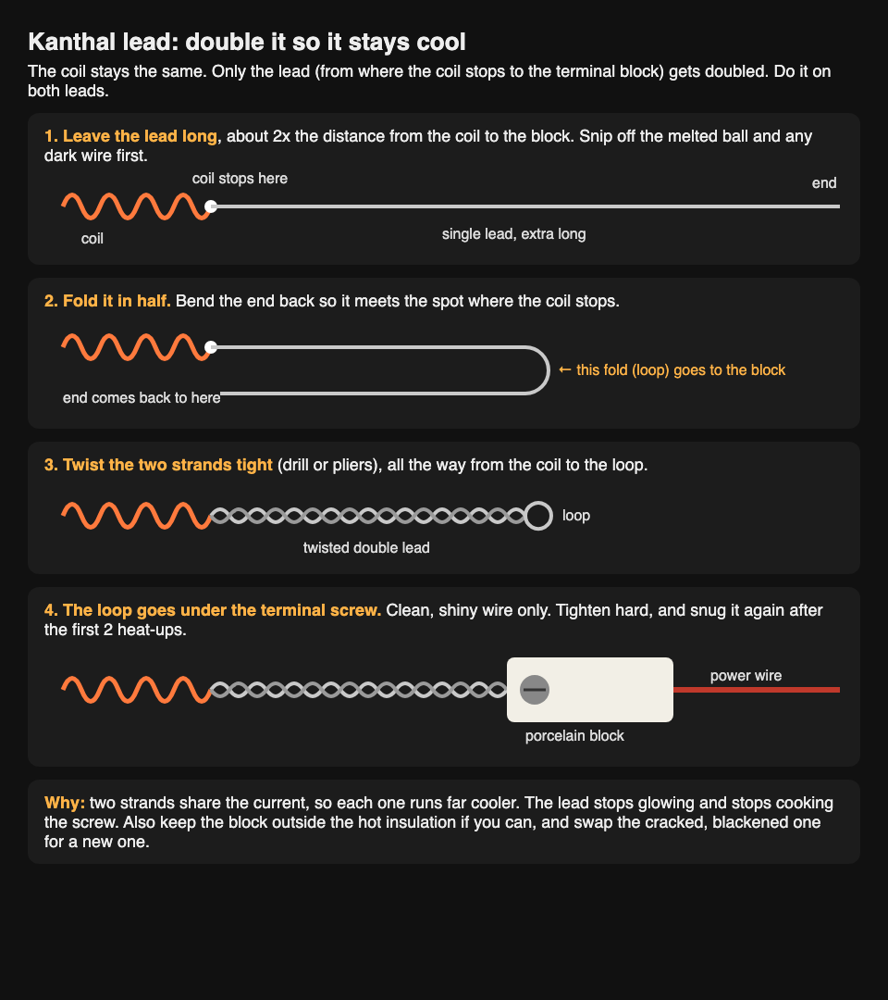

# Heater Leads: Kanthal to Terminal Block

How the two kanthal coil leads join the power wire, and how to keep the joint from burning up.

## What went wrong (2026-11-20 prototype)

The 1-way porcelain terminal block went black, the screw oxidized, the porcelain cracked, and the
bare kanthal lead melted into a ball at its tip.

Why: the lead was a single strand of the same thin kanthal as the coil, so it got as hot as the coil
all the way to the block. The heat oxidized the screw and the wire under it, the oxide raised the
contact resistance, and the joint began heating itself. Every heat cycle loosened the screw a little
more. The block also sat right against the hot core.

## The fix: a doubled "cold lead"

The coil stays the same. Only the lead, from where the coil stops to the block, gets doubled. Do it
on both leads.

1. **Cut back to clean wire.** Snip off any melted ball and any dark, dull or crusty wire until the
   kanthal is bright. Oxidized kanthal does not carry current well under a screw.
2. **Make room.** Leave the lead about 2x the distance from the coil to the block. If it's short,
   unwind one wrap at each end of the coil: one wrap around the core is about 29 cm (11 in). Losing
   one wrap per end makes the coil slightly stronger; the REX-C100 still holds the set temperature.
   Keep the last remaining wrap snug and not touching its neighbor.
3. **Fold it in half.** Bend the end back so it meets the spot where the coil stops.
4. **Twist the two strands tight** (drill or pliers), all the way from the coil to the fold.
5. **The folded loop goes under the terminal screw.** Clean, shiny wire only. Tighten it hard, and
   snug it again after the first 2 heat-ups (kanthal loosens as it cycles).

Two strands share the current, so each runs far cooler. The lead stops glowing and stops cooking
the screw.

## Block and insulation

- Replace any block that is cracked or blackened.
- Keep the block out of the hot zone when possible: the leads drop through the support ring holes
  into the 25 mm open space under the base, so the block can sit there instead of against the core.
- The doubled leads are insulated with ceramic fiber sleeve where they pass through the insulation.

Connection methods and insulation options (better blocks, crimp splices, ceramic beads) are being
researched; this page will be updated with the result.
